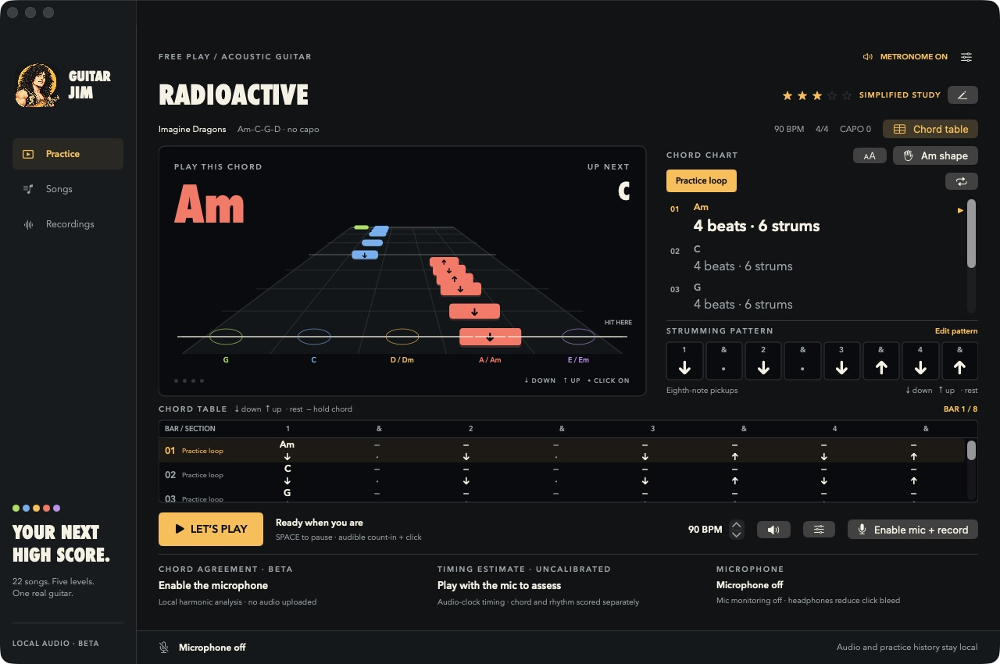
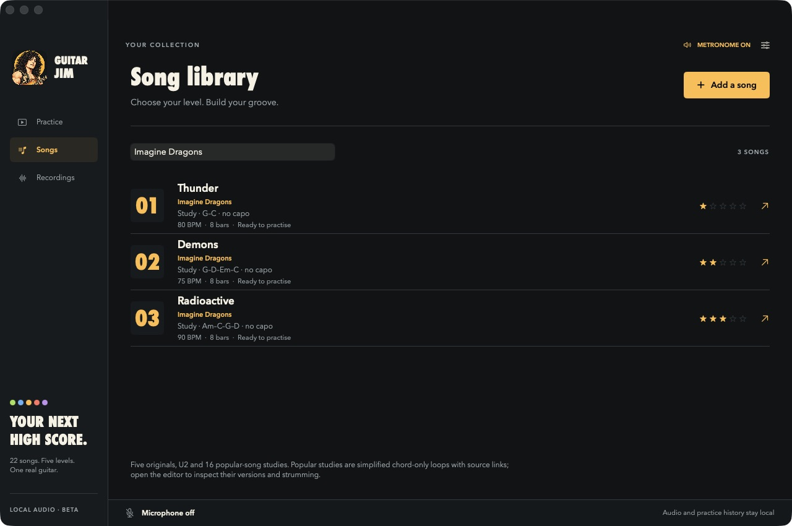
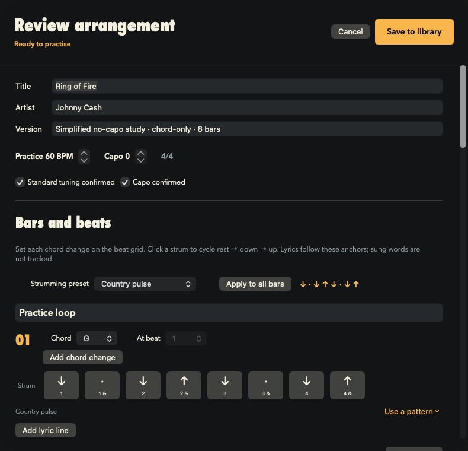

# Guitar Jim

[](https://github.com/nbnm/guitar-jim/actions/workflows/ci.yml)

A native macOS acoustic guitar practice prototype, based on the [product requirements](docs/Acoustic_Guitar_Practice_PRD.md). SwiftUI, AVFoundation and Core Audio; no third-party runtime dependencies.

The app uses an arcade note highway with descending strum gems, a strike line and several visible lyric lines. A live eight-slot strumming strip shows **1 & 2 & 3 & 4 &**, with downstrokes, upstrokes and rests. An optional chord table below the stage highlights the current bar and subdivision and scrolls with practice. Five original songs progress from steady downstrokes to syncopated eighths and mid-bar chord changes. **With or Without You** and [sixteen additional popular-song studies](docs/SONG_CATALOG.md) bring the starter library to 22 songs, including three each by Ed Sheeran and Imagine Dragons. The added studies are simplified eight-bar, chord-only exercises.

All practice audio stays on the Mac. Local spectral analysis estimates chords independently of the expected arrangement; timing and microphone signal quality are assessed separately. Estimates are beta features and abstain on unclear audio. Timing is explicitly labelled uncalibrated until a route offset is measured.

The metronome is audible by default. The four-beat count-in plays beeps synchronized with a pulsing ring, animated sound bars and the numbers 4–3–2–1, followed by a distinct GO chime. Clicks continue at the practice tempo, with an accent on the first beat of each bar. Use the speaker button to mute/unmute; Audio setup includes a volume slider and Test countdown sound button. Microphone monitoring remains off. Use headphones during scoring to reduce acoustic click bleed into the microphone.

## Screenshots

### Practice with the strumming guide and chord table



The eight-subdivision guide shows downstrokes, upstrokes and rests. During playback, the pattern and table highlight the same beat and follow the current bar.

### Search songs by title or artist

| Ed Sheeran | Imagine Dragons |
| --- | --- |
|  |  |

### Create and edit strumming patterns



Choose a preset for all bars or for one bar, or click individual slots to cycle **rest → down → up**. Presets preserve chord changes and lyrics. **Save to library** commits the draft; **Cancel** discards it.

## Run

Requires macOS 14 or newer and a Swift 6+ toolchain for the app and its Swift Testing suite. Development has been checked on Apple Silicon with Swift 6.3.3. Older OS and hardware coverage remain to be measured.

```sh
git clone https://github.com/nbnm/guitar-jim.git
cd guitar-jim
./Scripts/build-app.sh
open "build/Guitar Jim.app"
```

Use the app bundle for microphone access: it includes Apple's required microphone usage description. `swift build` alone builds the binary, without packaging the permission metadata. The development bundle is ad hoc signed; distribution signing and notarization are not configured.

1. Choose a song in **Songs**; search by title or artist. **First Light** is the easiest original; **Night Runner** is the hardest. Popular studies show their simplified version and source notes in the editor.
2. Select a passage. Start practice with the button or Space. Follow the audible count-in and pulsing countdown. Practise without a microphone if you only want the guide and click.
3. Open **Audio setup**, choose an input, adjust click volume, and optionally confirm a manually measured timing offset. No permission prompt or capture occurs on launch.
4. Choose **Enable mic and record**. All microphone input is now saved, including setup, count-ins and pauses. Space pauses practice while recording continues.
5. Choose **Turn mic off and save**. Open **Recordings** to replay, seek, loop an attempt, rename, delete or export WAV.
6. Use **Songs → Add a song** to paste or import plain text / ChordPro. Review every bar's timing and confirm local storage permission before saving.

The system menu bar also shows microphone state and a stop-and-save action. Direct mic monitoring is off. Selecting a recording stops and saves microphone capture before playback.

Use **Chord table** beside the tempo/capo information to show or hide the table; this preference is remembered. The strumming pattern stays visible alongside the lyrics/chord chart. Its highlight follows the practice clock, including rests. **Edit pattern** opens the arrangement editor: choose one of eight presets and **Apply to all bars**, use a bar's **Use a pattern** menu, or click individual slots to cycle rest → down → up. **Save to library** persists the pattern; **Cancel** discards draft changes. These are stroke guides; microphone scoring assesses audible attacks and harmony.

The app icon and sidebar use a generated cartoon portrait of Jimmy Page. The illustration is bundled locally; [logo assets and generation prompt](docs/LOGO.md) document its source and native icon packaging.

## Light Element

Open **Guitar Jim → Settings** to add the endpoint, model and token later. The token is stored in macOS Keychain, not a file or the app bundle. Endpoint and model are stored in UserDefaults. No credentials are required for local practice.

The initial adapter supports a **provisional OpenAI-compatible chat completions format**. Enter the complete HTTPS endpoint; the app does not append a path. Localhost HTTP is allowed for local development. Confirm the wire protocol with your deployment documentation before using live requests. The endpoint, token and supported model name are still outstanding.

The adapter sends only the entered request text and a fixed draft schema. It does not send microphone audio, practice history or stored lyrics. It creates chord-only **suggestions**, with no live source retrieval or claims of licensed content. Any lyrics returned unexpectedly by a model are ignored. Drafts require human timing, version, tuning, capo and storage review before practice. The endpoint is called only when you press **Create draft**.

## Verification

```sh
./Scripts/test.sh
./Scripts/build-app.sh
codesign --verify --deep --strict "build/Guitar Jim.app"
```

The test wrapper handles the Swift Testing framework search path used by standalone Command Line Tools. The [macOS workflow](.github/workflows/ci.yml) runs the suite, builds the bundle and verifies its signature on pushes to `main` and pull requests. It does not publish a release.

See [implementation status and remaining work](docs/IMPLEMENTATION.md) for requirement coverage, architecture, limitations and the manual audio validation plan. The PRD's numerical release targets have not been established. Synthetic chord fixtures exercise the algorithm; they do not establish real-guitar accuracy.

## Files and local data

- `Sources/GuitarPracticeCore`: arrangement schema, readiness checks, chart parser, rhythm matching, session records and model wire adapter.
- `Sources/GuitarPractice`: native interface, device selection, bounded capture handoff, chunk recording, local storage, playback and Keychain.
- `Tests/GuitarPracticeCoreTests`: schema, musical timing, spectral analysis, chord confusion, ring buffer, storage and audio export tests.
- `docs/Acoustic_Guitar_Practice_PRD.md`: converted source PRD, with its original links and illustration.
- `~/Library/Application Support/GuitarJim/Arrangements`: saved JSON arrangements.
- `~/Library/Application Support/GuitarJim/Sessions/<id>`: an immutable arrangement snapshot, markers, feedback and finalized audio chunks in `session.json` plus CAF files. Use **Open local recordings** in the app to inspect them.

## Included songs

| Level | Original song | Tempo | Strumming focus |
| --- | --- | --- | --- |
| 1 | First Light | 65 BPM | Quarter-note downstrokes, two chord shapes |
| 2 | Open Road | 80 BPM | Downstrokes with eighth-note pickups |
| 3 | A little closer | 80 BPM | Folk down/down-up/up-down-up pattern with a rest |
| 4 | Paper Satellites | 100 BPM | Syncopated eighths and minor chords |
| 5 | Night Runner | 120 BPM | Continuous eighths and mid-bar chord changes |

**With or Without You — U2** is an additional chord-only loop: G–D–Em–C shapes, capo 7, sounding D–A–Bm–G. Practice starts at 80 BPM; the reference tempo is kept separately. Confirm capo and the suggested timing in Arrangement before scored practice. See the arrangement’s source links for song metadata and licensed content options.

Direction arrows are guides. The microphone judges audible timing and harmony, not the direction of your hand or exact finger placement.

The source DOCX remains unchanged. Regenerate its Markdown with `python3 Scripts/convert_prd.py /path/to/Acoustic_Guitar_Practice_PRD.docx`.

## Platform references

Recording uses a dedicated [input-only Core Audio HAL unit](https://developer.apple.com/library/archive/technotes/tn2091/_index.html) with sample and host timestamps. The capture unit has output explicitly disabled, so Bluetooth speaker settings do not control its input sample rate. Local harmony analysis uses Accelerate FFTs and a spectral pitch-class profile; its evidence thresholds still need evaluation on held-out real guitar recordings. The app requests [microphone authorization](https://developer.apple.com/documentation/bundleresources/requesting-authorization-for-media-capture-on-macos) only after the player explicitly enables recording.
