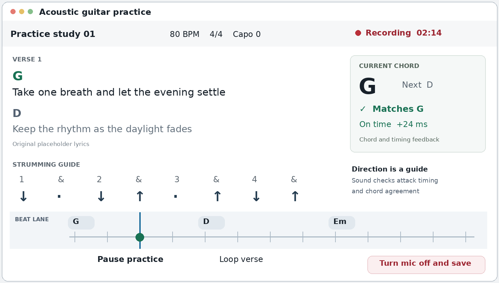

> Converted from `Acoustic_Guitar_Practice_PRD.docx`, version 0.1, 28 October 2026. The source requirements below are preserved as product input. The user subsequently selected **Light Element** for model access; see [implementation status](IMPLEMENTATION.md) for that integration and current delivery scope.

# Acoustic guitar practice app

Product requirements

Version 0.1  |  28 October 2026

## 1 Product direction

Build a macOS app that helps a guitarist practise a song while watching lyrics, chord changes, a strumming guide, and a moving beat lane. The app listens through a microphone, gives separate feedback on chord agreement and timing, and saves everything it captures for later playback.

The first release should help the player answer two questions during a passage: Did I play the expected chord, and did I strike it at the intended time? LLM-assisted song search should turn a request into an editable practice arrangement with visible sources.

### Primary user and outcome

A beginner or returning acoustic guitarist who knows a few open chords and practises alone at a Mac. The player wants confirmation during a song, a way to repeat difficult bars, and a recording to hear progress.

A successful session lets the player choose a song, prepare the arrangement, practise a passage, identify a chord or timing issue, repeat it, and replay both attempts.

### Proposed first release

| Area | Initial support |
| --- | --- |
| Playing | One acoustic guitar, standard tuning, solo strumming; A, Am, C, D, Dm, E, Em, G. |
| Timing | Fixed tempo from 50 to 140 BPM; 4/4; quarter and eighth note attacks and rests. |
| Songs | Natural language search, review and edit, manual chart import, and saved arrangements. |
| Practice | Lyrics and chord view, beat lane, chord diagrams, count-in, tempo control, section loops. |
| Audio | Built-in or external wired microphone; automatic local recording, replay, and export. |

Proposed baseline: Apple Silicon Mac with 8 GB RAM, macOS 14 or later. Confirm the supported OS range and hardware during prototyping. Saved, permitted content and live practice should work offline; search requires internet access.

Later scope includes singing while scoring, fingerpicking assessment, arbitrary chord types, alternate tunings, variable meters, adaptive tempo, and full song transcription. The player can still view and record material outside the scored repertoire.

## 2 Practice experience

The screen should remain readable from a seated playing position. Show the current phrase, the current chord and next change, and the next few beats without requiring the player to scroll or handle the mouse.

Illustrative layout with original placeholder lyrics. Values illustrate feedback states.

### The practice loop

- Choose a song or request one by title, artist, or skill level. Review the arrangement.

- Select the mic, enable recording, and check level, tuning, and timing calibration.

- Choose a passage and tempo, start a count-in, and follow the beat lane.

- Loop a difficult passage, then replay attempts from the same point.

### R01 Display and practice controls

Keep the song title, target BPM, meter, capo, current chord, upcoming chord, and recording status visible. Align chords to lyric phrases and beats. Advance the lyrics from the arrangement timeline; lyric highlighting follows that timeline. The MVP does not listen for sung words.

Provide start, pause, resume with count-in, bar selection, loop, tempo change, and metronome controls. Apply tempo edits at the next count-in and keep the chord and lyric mapping intact. Preserve separate attempts for comparison.

### R02 Accessible feedback

Use labels and shapes alongside color. Show Matches G, Different chord, Unclear audio, On time, Early, Late, and Missed as distinct states. Offer large text, reduced motion, keyboard transport controls, and visible focus. Space pauses the practice timeline; a separate visible control turns the microphone off and saves.

## 3 Chord and rhythm feedback

Evaluate musical events against an explicit arrangement. Keep the clock fixed at the chosen practice tempo. Automatic score following and a clock that follows the player belong to a later release.

### R03 Chord agreement

After an audible strum, estimate the sounding chord from a short harmonic window and compare its root and major or minor quality with the expected chord. Use the full supported vocabulary plus an unknown class. Use song context to stabilize estimates while preserving alternatives; the expected chord alone must never trigger a match.

| Result | Required behavior |
| --- | --- |
| Matches | Show a match only when the audio supports the expected chord above the validated confidence threshold. |
| Different chord | Show a mismatch only with confident contrary evidence. Name the heard chord only when its identity is also confident. |
| Unclear audio | Abstain for ambiguous, clipped, noisy, unsupported, or mixed audio. Exclude the event from chord accuracy. |
| Listening | Wait for an audible attack and usable evidence. Sustained sound must not create repeated new strums. |

Judge sounding harmony. Chord feedback does not establish finger position, exact voicing, or whether every string rings cleanly. Treat C versus Am and E versus Em as explicit confusion tests. A capo changes concert pitch; show the requested chord shape and evaluate its transposed sound.

### R04 Rhythm and strumming

Store expected audible attacks and rests on the beat grid. Group the successive string attacks within one strum into one event. Match each detected event to at most one expected attack and each expected attack to at most one detected event.

Proposed beginner window: On time means within ±90 ms of the target, capped at 25% of the interval to the nearest expected attack. Use a wider matching window of ±180 ms, capped at 45% of that interval, to label Early and Late. A usable interval without an attack becomes Missed; an unmatched attack becomes Extra. Validate these settings with players.

Show down and up strokes as a visual guide. Score their audible timing and chord agreement. The MVP cannot confirm hand direction or silent hand movements from the microphone. Show target BPM separately from any rolling tempo estimate, and suppress that estimate when the pattern leaves the pulse ambiguous.

### R05 Timing and score integrity

Timestamp attacks on the audio clock and compensate for the calibrated device offset. Use audio timestamps for judgment even if the chord result appears later. Avoid verdicts during uncertain chord transitions; show Unclear when the evidence stays mixed.

Report chord agreement as matches divided by judged chord attempts, alongside the judged count and coverage. Coverage equals judged chord attempts divided by eligible expected attacks. Report on-time attacks divided by expected attacks during usable audio, plus early, late, missed, and extra counts. Missed strums affect rhythm; unclear input reduces coverage. Show no score when the denominator is zero.

## 4 Song search and import

R06 Natural language request. Accept a request such as Find an easy acoustic version of a named song, using open chords. Search for matching versions and show the artist, recording or arrangement version, source, supported chords, and available content. Let the player choose among ambiguous matches.

### R07 Create a reviewable arrangement

- Retrieve available lyrics, chords, and tempo from sources whose terms permit the intended use. Keep a source and status for each field. A lyrics provider and a chord source may cover different versions.

- Use the LLM to interpret the request, normalize retrieved material, explain conflicts, and propose a beginner arrangement. Label generated chord changes, tempo, and strumming patterns as suggestions until the player confirms them.

- Show a review screen for version, tuning, capo, chord sequence, BPM, meter, section repeats, and strum pattern. Keep source tempo separate from chosen practice tempo. Offer manual BPM and tap tempo when the source lacks reliable tempo.

- Map chord changes and lyric lines to bars and beats. A chart with chords above words provides insufficient timing for scoring. Offer an editor to set chord durations, phrase starts, repeated sections, and attacks within each bar.

- Validate required fields before enabling scored practice. Preserve incomplete songs in chart view with recording available. Support paste or local import of plain text and ChordPro-style charts as a fallback.

### R08 Practice readiness

Use three visible states: Found, Needs review, and Ready to practise. Ready requires a chosen version, confirmed tuning and capo, a fixed BPM and meter, ordered sections with durations, chord changes on the beat grid, a strumming pattern, and available display content. Lyric line anchors are required when lyrics appear in the timed view.

Highlight unsupported chords and offer an editable simplification. After confirmation, score the simplified arrangement. Otherwise leave unsupported events unscored and show that coverage limit before starting. Resolve conflicting keys or versions on the review screen; never combine them without confirmation.

### R09 Content sources and failure handling

For a distributable app, select content providers whose agreements cover display, processing, and any offline storage required by the product. Musixmatch offers a licensed lyrics catalog, but provider selection and commercial terms remain open. [5] Treat public web access as discovery, with ingestion governed by source permissions. Keep required attribution and provider restrictions with each item.

Do not fill unavailable lyrics with LLM-generated text. Show a source link and offer permitted user-supplied content or chord-only practice. Handle no result, unavailable content, network failure, rate limits, and cancellation without losing edits. Validate imported fields and ignore instructions embedded in retrieved pages.

Cache a confirmed arrangement only where permitted. Reopening it must preserve the chosen version and edits. Keep lyric availability independent from whether chord and rhythm scoring can run.

## 5 Recording and replay

R10 Capture rule. Every microphone-active interval must produce a saved local recording, including setup, calibration, count-in, and paused practice. The player enables capture through an explicit Enable mic and record control. Request macOS microphone permission at that point. Apple requires permission before microphone capture. [1]

| Action or state | Capture and timeline behavior |
| --- | --- |
| Launch app | Microphone off. Restore previous songs and saved recordings. |
| Enable mic and record | Create a writable recording first, then capture. Show a persistent recording indicator, timer, and input level. |
| Pause practice | Pause scoring and the song timeline. Continue recording and display Practice paused · Recording. |
| Turn mic off and save | Stop input and scoring, pause the timeline, and finalize the recording. |
| Play a recording | Turn the mic off and finalize first. Replay without scoring the playback as a live performance. |
| Fault or interruption | Stop capture, preserve completed audio, mark any gap, and require an explicit restart. |

### R11 Save and recover

Write audio incrementally outside the audio callback. Keep recoverable chunks and a session manifest; target at most five seconds of unrecoverable audio after a crash. Record all active input without trimming silence. Capture the microphone channel without mixing in the app metronome; room bleed can still enter the microphone.

Continue user-enabled capture while the app is minimized and show a menu bar recording state. Turn the mic off on app quit, system sleep, permission loss, device removal, or recording failure. Device changes create a marked segment and require recalibration. Never switch to another microphone without the player choosing it.

If storage cannot accept more audio, stop the microphone and show the saved portion and the reason. Show storage use and estimated remaining recording time. Retain recordings until the player deletes them; provide individual deletion and storage management.

### R12 Listen after practice

List recordings by song, date, duration, and practice tempo. Preserve one continuous capture session with markers for setup, pauses, section loops, and attempts. Allow waveform seeking, passage looping, rename, delete, and M4A or WAV export. Keep an immutable arrangement snapshot and timestamped feedback so replay shows what the app assessed at that moment.

Compare attempts at the same passage and tempo. Leave the audio available when analysis fails. The MVP keeps audio on the Mac and uses local analysis; song search must never upload microphone audio or practice history.

## 6 System requirements

### R13 Audio setup and calibration

Offer input selection, a level meter, and checks for silence, clipping, and background sound. Guide the player to tune before scoring and confirm tuning and capo. Measure or calibrate input and output offset for each device route. Headphones reduce metronome and playback bleed. Keep direct microphone monitoring off by default.

Pause judgment during input faults. Restore scoring only after the route and input quality pass checks. Treat simultaneous singing, another instrument, and a backing recording as unsupported scoring conditions in the MVP; retain the recording and display reduced confidence when the app detects interference.

### Proposed implementation

Use SwiftUI for the desktop interface and an AVFoundation or Core Audio capture pipeline. Apple provides audio-node taps for recording and observation. [2] Benchmark the actual callback delivery and device latency before choosing the capture API. Keep disk writing, signal processing, and rendering away from the capture callback.

| Component | Responsibility |
| --- | --- |
| Capture and recorder | Own the input device, sample timestamps, bounded audio buffers, chunk writing, and recovery. |
| Local analysis | Detect attacks, estimate harmonic evidence, output chord candidates and confidence, and flag unusable audio. |
| Practice engine | Own the beat clock, arrangement events, loops, count-in, one-to-one event matching, and feedback history. |
| Song importer | Run search and LLM requests, normalize data, track sources and permissions, and validate arrangements. |
| Local store and replay | Keep arrangements, immutable session snapshots, audio segments, event markers, and exports. |

Prototype both a chroma-based chord matcher and a compact polyphonic pitch model. Essentia documents an experimental major and minor chord detector with a default two-second centered window. That implementation does not establish live-feedback latency. [3] Spotify Basic Pitch supports polyphonic transcription and a Core ML runtime; its authors say it works best with one instrument. [4] Neither source proves performance for this app. Choose the approach from measured accuracy, latency, and redistribution terms.

### R14 Data and privacy

Represent each song with version, tuning, capo, tempo, meter, sections, lyric lines and anchors, chord events, strum events, field sources, and content permissions. Store musical time in bars and beats. Represent each session with audio sample timestamps, wall-clock start, device and calibration, arrangement version, tempo changes, and separate detected and expected events.

Keep search credentials in a backend or macOS Keychain as appropriate; never ship shared secrets inside the app. Send only the text needed for song discovery and permitted normalization. Make diagnostics optional, exclude audio and lyrics from logs, and provide local deletion. Cached practice must remain usable during network outages, subject to content permissions.

## 7 Validation and release

All numerical thresholds below are proposed engineering targets. The team must measure them on the supported hardware and capture routes before promising them to users.

| Measure | Proposed release criterion |
| --- | --- |
| Rhythm feedback latency | 95th percentile at or below 150 ms from an audible attack to the first timing indicator. |
| Chord feedback latency | 95th percentile at or below 500 ms after a supported chord change with usable strummed audio. |
| Chord reliability | At least 90% balanced accuracy on judged attempts and 80% coverage. False Matches on labeled incorrect attempts at or below 5%. |
| Attack detection | F1 at least 0.90 within ±40 ms of annotated attacks; median absolute timing error at or below 25 ms. |
| Clock and recording | At most 25 ms recording-to-timeline drift over 30 minutes. A 60-minute session has no unexplained recording gaps. |
| Recovery and faults | Recover finalized chunks after a forced crash. Device loss, permission denial, and disk-full paths stop capture and preserve saved audio. |
| Import and first use | Every Ready song passes schema and timeline validation. At least 8 of 10 pilot users complete import, practice, a loop, and replay without coaching. |

### Evaluation method

Use consented, annotated recordings from at least ten players and five acoustic guitars across built-in and USB microphones. Include all supported chords, different strum strengths and tempos, quiet and moderately noisy rooms, near-confusable wrong chords, muted strings, silence, clipping, vocals, and playback bleed. Measure results by chord, player, device, and condition.

Keep players in the held-out evaluation separate from model tuning and confidence calibration. Freeze thresholds before that evaluation. Have a guitarist verify chord labels and attack times, with a second reviewer resolving ambiguous examples. Report abstentions and coverage beside accuracy so the app cannot pass by declining most attempts.

### Product measures

Track time to first completed practice and replay, the share of imports ready without manual timing edits, and return practice within seven days. For repeated passages, compare timing error and chord agreement at the same tempo and arrangement while showing coverage. Use these measures to test whether the player learns and trusts the feedback; offline detector accuracy alone cannot establish learning.

Collect pilot measures through consented test sessions or optional aggregate diagnostics. Set retention and learning targets after the pilot establishes a baseline.

## 8 Delivery sequence and decisions

### Delivery sequence

| Step | Concrete result required to proceed |
| --- | --- |
| 1 Prove the feedback | Record and replay the eight supported chords and simple strum patterns. Meet accuracy, coverage, and latency targets on a beat lane. |
| 2 Build the practice loop | Use original or permitted songs to complete setup, count-in, lyric and chord display, section loops, recording recovery, and replay. |
| 3 Add dynamic song import | Connect permitted sources and LLM search. Complete version selection, timing review, fallback import, and Ready validation. |
| 4 Run a private pilot | Test first-use tasks and repeated practice. Resolve false feedback, data loss, and content-source gaps before wider distribution. |

### Decisions to confirm

Distribution and content budget. Start with a private prototype. For a third-party song catalog, confirm access terms and budget for lyrics, chord material, search, and LLM calls. Confirm permitted display, processing, and caching before selecting providers.

Initial repertoire. Choose five to ten target songs and languages to test retrieval quality, capo handling, simplification, and manual timing effort. Keep the original version and the beginner arrangement distinct.

Playing conditions. Confirm whether singing while strumming must enter the first release. The proposed MVP assesses solo guitar and records mixed performances with limited or unavailable scoring.

Hardware coverage. Validate the proposed macOS and Apple Silicon baseline, then decide whether to include Intel Macs and Bluetooth routes. Publish only the device combinations that pass calibration and timing checks.

### Technical and content references

Sources checked 28 October 2026. References support platform capabilities and known constraints. The requirements, thresholds, and delivery sequence above are product proposals.

[[1] Apple  Requesting Authorization for Media Capture on macOS](https://developer.apple.com/documentation/bundleresources/requesting-authorization-for-media-capture-on-macos)

[[2] Apple  AVAudioNode and audio taps](https://developer.apple.com/documentation/avfaudio/avaudionode)

[[3] Music Technology Group  Essentia ChordsDetection](https://essentia.upf.edu/reference/std_ChordsDetection.html)

[[4] Spotify Audio Intelligence Lab  Basic Pitch](https://github.com/spotify/basic-pitch)

[[5] Musixmatch  Lyrics and metadata API overview](https://www.postman.com/musixmatch-dev/musixmatch-apis/overview)
